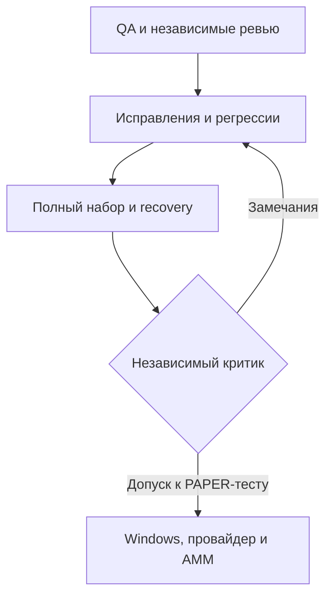

# Проверка v0.7.101.1: агенты, исправления и карта процесса

Создано: 2026-10-31T23:59:35.092505+00:00. Итог: PASS_FOR_WINDOWS_PAPER_TEST после исправлений и второго раунда независимой критики. Готовность к live не подтверждена.

## Что сохранили

Дорожную карту, торговые пороги, размер PAPER-позиции, общий RPC-лимит, свежесть проверок, строгий финансовый журнал и владение дочерними процессами. Изменение конфигурации относительно v101 — только VERSION. Реальные средства и ключи пользователя не использовались.

## Кто проверял

| Роль | Область |
|---|---|
| QA | Изолированные копии, полный pytest, recovery, точные результаты XML |
| Надёжность | RPC admission, outcomes, cooldown, восстановление, процесс и STOP |
| Продукт | Лёгкий API, дашборд, учёт, инструкции и перенос кампании |
| Независимый критик | Повторная оценка кандидата, границы PASS и замечания вне первоначального ревью |
| Основной агент | Независимые воспроизведения, проверка предложенных исправлений, интеграция и упаковка |

Агенты работают внутри текущей сессии. Постоянных отдельных участников чата или непрерывного фонового тестирования после её окончания не создавали.

## Исправления и доказательства

| Приоритет | Дефект | Исправление и регрессия |
|---|---|---|
| P1 | PermissionError при перечислении outcomes подавлялся Path.glob. Каталог с неприменённым результатом мог считаться пустым, а audited recovery — разрешаться. | Строгий os.scandir; неизвестное чтение → Deferred(OUTCOME_READ_BUSY), восстановление отказывает. Сохранённый 429 применяется после восстановления доступа; исходный Retry-After не теряется. Проверены отказ открытия и отказ итерации. |
| P1 | Неизвестный промежуточный RPC-счётчик превращался в ноль: неизменившиеся 734 → 734 могли дать ложный PASS возобновления. | Неизвестное значение остаётся null; PASS требует роста между двумя достоверными наблюдениями. В отчёте сохранены status/valid/value; возможна поздняя установка достоверной базы после восстановления чтения. |
| P2 | Ранняя ручная остановка с долгим завершением пересекала duration и получала PASS. | Завершённый прогон требует запроса STOP таймером теста. Ранний STOP остаётся неполным. |
| P2 | Поздний отказ чтения outcomes терял failure_chain и мог заменить BLOCKED на UNAVAILABLE. | Единый обработчик сводки сохраняет BLOCKED, точную безопасную причину и pending_outcomes=null. Проверены оба исходных состояния. |
| P2 | ROUTE перезаписывал счётчик verified_exits полной историей settlement. | Поле снова число; сырые details не попадают в /overview. Модель расходов получает генератор строк. На синтетических 100 записях API сократился примерно с 461 тыс. до 21 тыс. символов. Это не измерение RSS работающего бота. |
| P2 | HTML панелей сохранил старую метку версии при подготовке релиза. | Обновлены обе панели; smoke и проверки overview пройдены повторно. |

Пятнадцать новых регрессий включены в mandatory recovery и не дублируются в техническом остатке. Также проверено, что во время паузы после отказа чтения RPC-приоритета другой владелец может захватить metadata.lock и все четыре слота. Общий лимит и cooldown не обходятся.

## Цикл критики

1. Первичное ревью нашло три ошибки. Они воспроизведены, исправлены и покрыты тестами.
2. Критик вернул CHANGES_REQUIRED: неизвестный счётчик и поздняя ошибка snapshot.
3. Исправления прошли повторные регрессии; критик независимо подтвердил обе правки.
4. Полный набор выявил две проверки старой HTML-метки; метка исправлена, связанные проверки повторены.
5. Окончательные полный QA и recovery прошли; критик второго раунда разрешил следующий Windows PAPER-тест. Предыдущие неуспешные и незавершённые прогоны не засчитываются как PASS.

## Итоговые проверки

| Проверка | Итог |
|---|---|
| Полный набор, завершённый XML и код 0 | 1303 PASS, 16 SKIP, 0 ошибок; 183,695 с |
| Controlled recovery, код 0 | 590 PASS, 15 SKIP; 148,554 / 600 с |
| Новые регрессии обязательного recovery | 15 PASS, agent_review_models_passed_v1011=true |
| Согласованность recovery/acceptance | Оба passed=true; native_windows_verified=false |
| Независимый критик, раунд 2 | PASS_FOR_WINDOWS_PAPER_TEST |
| Свежая распаковка, ZIP CRC и release manifest | PASS — проверены при финальной упаковке |

Пропуски относятся к нативным механизмам Windows и ограничениям пространства PID/procfs этой Linux-среды. Они не заменены зелёными отметками. Наборы полного pytest и recovery пересекаются; суммы не являются числом уникальных тестов.

Исходный полный прогон исправленного кандидата до исправления HTML: 1319 тестов, 1301 passed, 16 skipped, 2 failed, 183,805 с. Сетевой тест, ошибочно заподозренный в зависании по усечённому текстовому журналу, в XML завершился за 0,307 с. Оснований объявлять его причиной зависания нет. Для итогов используются завершённый XML и код возврата.

Независимые локальные проверки критика: 15 новых регрессий; ещё 95 проверок изменённых путей. Ранее также пройдены 59 проверок STOP, ownership, receipts, release guard, UI и расходов. Эти наборы частично пересекаются; их количества не складываются в число уникальных тестов.

## Карта продвижения

Карта подготовки релиза отделена от торговой дорожной карты. Локальные тесты не повышают автоматически её контрольные пункты Windows, текущего AMM и закрытия всех ROUTE-входов.

## Что осталось проверить на целевой машине

- Windows Python 3.14: полный 04_CHECK и новый согласованный recovery/acceptance этой версии.
- Текущий провайдер: RPC-допуск с сохранённым общим лимитом. Перед отдельной сетевой проверкой штатно остановить бота — разрешён один WebSocket.
- Физический двухчасовой PAPER-прогон с инъекцией; после отказа должен наблюдаться рост started по достоверным снимкам, не просто отсутствие BLOCKED. started доказывает допуск запросов, а не успешность HTTP-ответа.
- Фактическое состояние открытых ROUTE-остатков, закрытие писателей, отсутствие потерь очередей и целевой выход на текущем AMM.
- Сопоставимая база расходов и накопление выборки по исходной дорожной карте. Эти задачи не объявлены закрытыми данным ревью.

Нативные Windows-пропуски не являются PASS Windows. Проверка со смещением времени и историческая AMM-фикстура не доказывают актуальный пул/исполнение. Причины старых отказов Windows и задержек CreateProcessW остаются неустановленными. Снижение памяти и прибыльность не подтверждались.

Установка — в новую папку. При продолжении кампании переносить полную остановленную app/data по RELEASE_NOTES_v101.md, не смешивать файлы релизов и не удалять control_failed.json. Последовательность: 04_CHECK → 14_RPC_STATUS → 03_START или 15_PAPER_FAULT_TEST → штатный STOP → 05_RESULTS. Успешный локальный критик означает готовность к следующему Windows PAPER-тесту, а не разрешение live.
