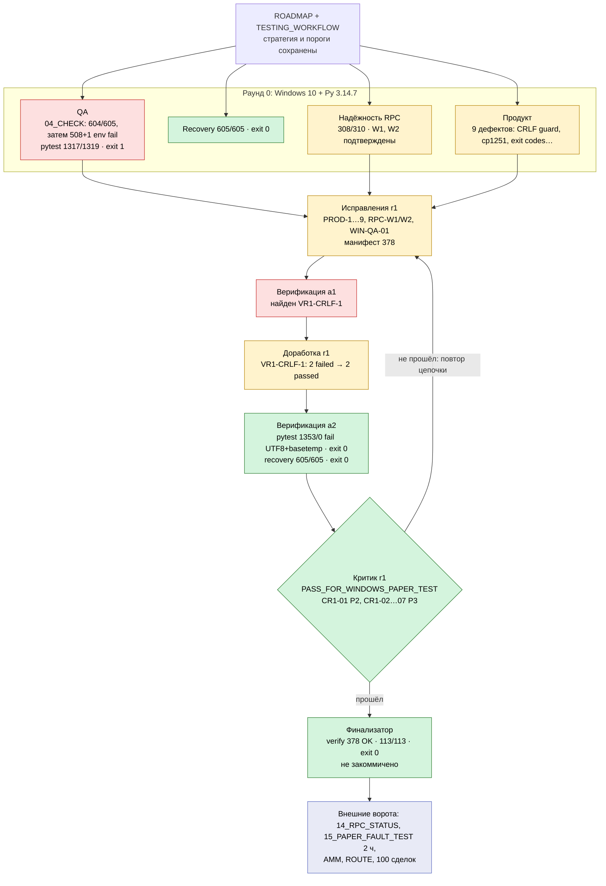

# Проверка v0.7.101.1 на нативной Windows 10 и Python 3.14: агенты, исправления и карта процесса

Создано: 2026-11-01. Итог: **PASS_FOR_WINDOWS_PAPER_TEST**. Его дал независимый критик в раунде 1 после исправлений и верификации. Готовность к live не подтверждена. Изменения в рабочем дереве worktree `testing-strategy-agents-116a19` **не закоммичены**, ZIP не пересобран.

Окружение: Windows 10 Pro 19045, Python 3.14.7 (venv в scratchpad), кодовая страница cp1251, `core.autocrlf=true`, `.gitattributes` в репозитории нет. Все прогоны шли в изолированных копиях `scratchpad/runs/*`. Сеть провайдера RPC, рыночные WebSocket, ключи, кошелёк и пользовательские БД не использовались. Единственное внешнее обращение — NTP `time.cloudflare.com` UDP/123 внутри штатного 04_CHECK (раунд QA, без изменения часов).

## Что сохранили

- Дорожную карту (ROADMAP.md не изменялся) и все её этапы: проверенный PAPER-выход, общий лимит, раздельные Curve/AMM-выходы, 100 закрытых сделок для этапа 2, пилот только после предыдущих этапов.
- Торговые пороги, размер PAPER-позиции, общий RPC-лимит (rate, slots, wait, RECOVER_AFTER_SECONDS), правила свежести, строгий финансовый журнал, владение дочерними процессами. `app/config.py` не изменялся.
- VERSION `v0.7.101.1` в `config.py` и `release_guard.py`, а также `build_revision` манифеста не менялись (см. CR1-03).
- Ни один тест не пропущен, не помечен xfail и не ослаблен. Единственная правка утверждений по времени — перевод `test_priority101_retry_after_capacity_rate_still_enforced` на управляемые часы RateClock; сами утверждения те же.

## Кто проверял

| Роль (stage) | Область | Итог раунда 0 |
|---|---|---|
| QA (`bootstrap_check`, `qa_full`, `recovery`) | 04_CHECK-эквивалент дважды, полный pytest, controlled recovery, JUnit и коды выхода | fail / fail / pass |
| Надёжность (`review_rpc`) | RPC-регулятор, outcomes, cooldown, STOP, SQLite; реальные Win32-хендлы через CreateFileW | changes (W1, W2; W3/W4 по времени) |
| Продукт (`review_product`) | .bat-сценарии, release_guard на git-checkout, дашборд, README, путь с пробелом и кириллицей | changes (9 дефектов) |
| Исправления (`fix`) | Правки с регрессиями, пересчёт манифеста, журнал FIX_LOG_RU.md | раунд 1 + доработка VR1-CRLF-1 |
| Верификация (`verify`) | Связанные тесты, полный pytest (с PYTHONUTF8 и без), recovery | 2 прохода (a1, a2) |
| Независимый критик (`critic`) | Повторная оценка кандидата, атакующие пробы guard, повтор воспроизведений | PASS_FOR_WINDOWS_PAPER_TEST |
| Финализатор (`final`) | Проверка манифеста механизмом проекта, итоговый прогон, этот отчёт | pass |

Агенты работали внутри текущей сессии. Постоянных фоновых участников или непрерывного тестирования после неё нет.

## Дефекты и исправления

Подробности и команды воспроизведения: `validation/win314/FIX_LOG_RU.md`.

| ID | Приор. | Дефект на Windows | Исправление | Регрессия |
|---|---|---|---|---|
| PROD-1 | P1 | git-checkout с `core.autocrlf=true` превращает 346 из 375 файлов в CRLF; release_guard блокирует все .bat (`CLEAN_RELEASE_FILE_CHANGED`) | `release_guard.verify`: для текстовых суффиксов при несовпадении сырого SHA-256 — повторный потоковый хеш с CRLF→LF. Любое другое отличие и любой двоичный файл по-прежнему блокируются | `test_win314_release.py`; атакующие пробы критика (`critic_r1_guard_probe.py`): `\r\r\n`, одиночный CR, порт 8188→8189, CRLF-`.zip`, лишний модуль — блокируются |
| PROD-2 | P2 | 11_PERF_CHECK всегда падает на cp1251 (`read_text()` без кодировки; `-I` игнорирует PYTHONUTF8) | `perf_check_v87.py`: `encoding='utf-8'` | `test_win314_tools.py` (подпроцесс `-X utf8=0`); 11_PERF_CHECK: PASS, exit 0 |
| PROD-3 | P2 | 06/09/10/11.bat возвращали 0 при провале | Проверка `.venv` и `exit /b %CHECK_CODE%`, как в 12–15 | cmd + заглушка bootstrap: коды 0/1/7 передаются |
| PROD-4 | P3 | priority101 retry-after тест зависел от планировщика | Управляемые часы RateClock, утверждения без изменений | 5/5 PASS |
| PROD-5 | P3 | README.md описывал v0.7.62 | Переписан под v0.7.101.1 | документ |
| PROD-6 | P3 | 05_RESULTS терял причину отказа | `REPORT FAILED: <причина>` только для фиксированных подсказок; произвольный текст исключений не экспортируется | `test_win314_tools.py` (секрет из RuntimeError не утекает) |
| PROD-7 | P3 | На пустой БД возраст рыночных данных ≈56 лет | 0/None = «нет данных» | `test_win314_tools.py` |
| PROD-8 | P3 | На пустой установке «Монитор: STATE_READ_ERROR» | До первого старта — NOT_STARTED; после старта отсутствие файла остаётся STATE_READ_ERROR | те же тесты |
| PROD-9 | P3 | 06_AMM_CHECK без интерактивного ввода — трассировка | `INPUT_UNAVAILABLE`/`INPUT_INVALID`, passed=false, exit 1, RPC не вызывается | `test_win314_tools.py` (2 варианта) |
| RPC-W1 | P2 | Маркер `control_failed.json`, запись которого запрещена чужим хендлом, блокировал только свой процесс; остальные продолжали допуск | Неудачная запись хранится в памяти и повторяется в `blocked()` под RLock до fsync | `test_win314_rpc.py`; реальный CreateFileW: после освобождения другой процесс получает `RPC_CONTROL_BLOCKED`. Остаток — CR1-04 |
| RPC-W2 | P2 | Чужой хендл на outcome `.tmp` 0,5 с останавливал все PAPER RPC ≈10,3 с | Убран 10-секундный порог возраста `.tmp`; владение доказывается захватом publisher-слота | `test_win314_rpc.py`; восстановление 2,27 с вместо 10,26 с |
| WIN-QA-01 | — | Тест 429-контенции ждал синхронного удаления, которое делает асинхронный поток | Тест: квитанция обязательна, удаление — ограниченное ожидание 10 с | детерминированный тест с задержкой потока очистки, 5/5 |
| VR1-CRLF-1 | P3 | Экспорт dashboard.html в текстовом режиме превращал CRLF шаблона в CR CR LF | `write_text(..., encoding='utf-8', newline='')` | `test_win314_exported_dashboard_keeps_template_line_endings[crlf,lf]`: до 2 failed (`<html>\r\r\n`), после 2 passed |

Отклонено без правки кода (решение зафиксировано, порог не ослаблен):

- **WIN-QA-02** — CreateProcessW простоял 27,8 с при ≈17 параллельных python.exe. Обработка штатная: дедлайн, Job terminate, CLEANUP_CONFIRMED (0 активных процессов). Первопричина остаётся открытым пунктом ROADMAP.
- **RPC-W3** — отклонение начала HTTP на 9–14 мс после штампа (закрытие metadata.lock и вытеснение планировщиком). Спейсинг штампов и средний темп 6/с соблюдаются. Допуск теста не ослабляли.

`BUILD_MANIFEST.json`: пересчитаны LF-хеши 13 изменённых файлов и добавлены 3 новых теста (`test_win314_release.py`, `test_win314_rpc.py`, `test_win314_tools.py`), всего 378 файлов. Эти три файла включены в `TECHNICAL_TEST_FILES` (check_plan_v972), то есть 04_CHECK их выполняет.

## Цикл критики

| Раунд | Исправлено | Верификация | Критик |
|---|---|---|---|
| 0 | — | QA: 04_CHECK fail (604/605, затем 508+1 fail по окружению), полный pytest 1317/1319; recovery 605/605 | — |
| 1 (fix_r1) | PROD-1…9, RPC-W1, RPC-W2, WIN-QA-01 | a1: найден VR1-CRLF-1 → доработка | — |
| 1 (доработка) | VR1-CRLF-1 | a2: без PYTHONUTF8 6–7 падений только из-за чтения тестами UTF-8 через cp1251; с PYTHONUTF8 и коротким basetemp 1353/0 fail; recovery 605/605 | **PASS_FOR_WINDOWS_PAPER_TEST** |

Повторного раунда не потребовалось: критик не нашёл блокирующих дефектов (P0/P1 или P2, обесценивающих PAPER-тест).

Оставшиеся замечания критика (`CRITIC_ROUND1_RU.md`):

| ID | Приор. | Суть | Тип |
|---|---|---|---|
| CR1-01 | P2 | `test_native_late_owner_survives_stop_and_reaps_tree` (в recovery-наборе 04_CHECK) в длинных прогонах иногда даёт `DELAYED_CLEANUP_CONFIRMED` вместо `LATE_PROCESS_CLEANED`. Утверждения безопасности проходят, 12 отдельных прогонов файла — 96/96. 04_CHECK пользователя может изредка падать | ненадёжный тест, Windows |
| CR1-02 | P3 | Тайминговые RPC-тесты recovery (rpc94, cold-start 4 процесса) чувствительны к нагрузке; в прогонах критика прошли | Windows, под нагрузкой |
| CR1-03 | P3 | `build_revision`/VERSION не отличают кандидата от исходного ZIP | упаковка |
| CR1-04 | P3 | RPC-W1, остаток: пока чужой хендл держит маркер, другие процессы продолжают допуск; `close()` не повторяет запись | локально fail-closed |
| CR1-05 | P3 | 6 тестов читают UTF-8 HTML без `encoding` и падают на cp1251 без PYTHONUTF8 (04_CHECK.bat его задаёт) | **исправлено после критика**: `encoding='utf-8'` в тестах, 59/59 на cp1251 без PYTHONUTF8, manifest обновлён |
| CR1-06 | P3 | venv по пути длиннее MAX_PATH ломает загрузку DLL (cryptography, psutil) | только окружение |
| CR1-07 | P3 | Залоченная ACL ссылка `%TEMP%\pytest-of-OMG\pytest-current` ломает basetemp по умолчанию | только окружение |

## Итоговые проверки

Источник — JUnit XML и коды выхода процессов. Файлы лежат в `validation/win314/`.

| Проверка | Пройдено | Упало | Пропущено | Секунд | Exit | Артефакт |
|---|---:|---:|---:|---:|---:|---|
| QA r0: 04_CHECK прогон 1, recovery-стадия | 604 | 1 | 0 | 250 | 1 | `qa_r0_check_recovery_tests.xml` |
| QA r0: 04_CHECK прогон 2, recovery-стадия | 605 | 0 | 0 | 226,7 | 0 | `qa_r0_check2_recovery_check_v89.json` |
| QA r0: 04_CHECK прогон 2, технический остаток | 508 | 1 (окружение) | 1 | 318 | 1 | `qa_r0_check2_stdout.log` |
| QA r0: полный pytest | 1317 | 1 (CreateProcessW) | 1 | 428,7 | 1 | `qa_r0_full.xml` |
| QA r0: controlled recovery | 605 | 0 | 0 | 259 | 0 | `qa_r0_recovery_check_v89.json` |
| Верификация a2: связанные тесты, cp1251 | 329 | 6 (CR1-05) | 0 | 76,6 | 1 | `verify_r1_a2_related.xml` |
| Верификация a2: связанные тесты, PYTHONUTF8=1 | 335 | 0 | 0 | 76,6 | 0 | `verify_r1_a2_related_utf8.xml` |
| Верификация a2: полный pytest, cp1251 | 1346 | 7 (CR1-05, CR1-07) | 1 | 365,7 | 1 | `verify_r1_a2_full.xml` |
| Верификация a2: полный pytest, PYTHONUTF8=1 | 1352 | 1 (CR1-07) | 1 | 363,2 | 1 | `verify_r1_a2_full_utf8.xml` |
| Верификация a2: полный pytest, PYTHONUTF8=1, короткий basetemp | **1353** | **0** | 1 | 364,6 | **0** | `verify_r1_a2_full_utf8_bt.xml` |
| Верификация a2: controlled recovery | **605** | **0** | 0 | 251 | **0** | `verify_r1_a2_recovery_check_v89.json` |
| Критик r1: полный pytest, PYTHONUTF8=1 | — | CR1-01 и CR1-06 | — | — | 1 | `critic_r1_full_utf8.xml` |
| Критик r1: повтор wallet/signer по прямому пути venv | 41 | 0 | 1 | — | 0 | `critic_r1_rerun_direct.xml` |
| Финализатор: свежая CRLF-копия `runs/final_r1`, `release_guard.verify` | 378 файлов | 0 | — | — | 0 | — |
| Финализатор: test_win314_* + clean_release + check_plan + smoke + monitor_v30 + priority101 + rpc_outcomes_v892, PYTHONUTF8=1 | **113** | **0** | 0 | 18,0 | **0** | `final_r1_targeted.xml` |

Полностью зелёным полный pytest стал только с PYTHONUTF8=1 и basetemp вне сломанного `pytest-of-OMG`. Остальные падения объясняются окружением (CR1-05, CR1-06, CR1-07) или нагрузкой от параллельных агентов (CR1-01, CreateProcessW). Ни одно из них не связано с торговой или учётной логикой. Полный 04_CHECK.bat в зелёном виде после исправлений одним прогоном не получен: его стадии (recovery 605/605, полный pytest) пройдены по отдельности.

## Нативные Windows-проверки: что теперь реально пройдено

Пройдено на Windows 10 + Python 3.14.7 (на Linux эти проверки пропускались или не существовали):

- 16 тестов, которые на Linux пропускались, теперь выполняются и проходят: Job Object, дерево процессов, нативный ридер, sharing violation, late spawn, владелец и PID воркера.
- Controlled recovery 605/605: `acceptance_v90.passed=true`, `native_windows_verified=true`, все версии `*_windows_verified=true`.
- Реальные Win32-хендлы (CreateFileW) на маркере отказа и outcome `.tmp`: после исправлений поведение fail-closed и самовосстановление за 2,27 с.
- CTRL_BREAK через редиректор venv `python.exe`, asyncio.run и SIGBREAK→KeyboardInterrupt: чистое завершение, rc 0.
- Импорт всех модулей с `-W error::DeprecationWarning` на 3.14: 0 ошибок. mmap rate-файла с ftruncate работает без ошибок.
- .bat в пути с пробелом и кириллицей (`pr Тест б`); release_guard на CRLF git-checkout; дашборд на пустой БД (/, /details, /api, /overview, /health → 200, консоль без ошибок).

Остаётся пропущенным или не доказанным:

- `test_loose_permissions_and_symlink_rejected` — нужны POSIX-права, на Windows пропуск ожидаем (1 skip).
- Флаги `windows_kernel_createprocess_hang_fixed_v85`, `windows_cleanup_root_cause_fixed_v84`, `windows_suspend_resume_proven`, `live_rpc_proven` по замыслу остаются false.
- Первопричины зависания SQLite и простоя CreateProcessW не воспроизведены и не установлены.
- Не запускались: 01, 02, 03, 07, 08, 12, 13, 14, 15 (сеть или интерактивный ввод).

## Оставшиеся внешние ворота (до решения о live)

1. **14_RPC_STATUS** — проверка реального RPC-провайдера пользователя (`rpc-status --recover --probe`). Агенты сеть не трогали.
2. **15_PAPER_FAULT_TEST** — двухчасовой PAPER-прогон с отказом (`--duration 7200 --fault-at 3600 --fault-for 10`) на машине пользователя.
3. **AMM** — 06_AMM_CHECK с реальным целевым токеном и текущие AMM-выходы (сейчас 0). 10_TEST_AMM_STOP — остановка во время AMM-продажи.
4. **ROUTE** — довести открытые остатки ROUTE до закрытия без разрыва учёта; сравнить модели расходов PRIMARY и ROUTE.
5. **Выборка стратегии** — этап 2 ROADMAP требует 100 закрытых сделок в новой кампании; прежние результаты v0.7.95 не переносятся.
6. Решения по CR1-01 (стабилизация native late-spawn теста без ослабления) и CR1-03 (новая метка сборки при упаковке ZIP).

## Карта процесса

Живая карта статусов: `validation/LIVE_MAP/` (обновляется через `set_status.py`).
